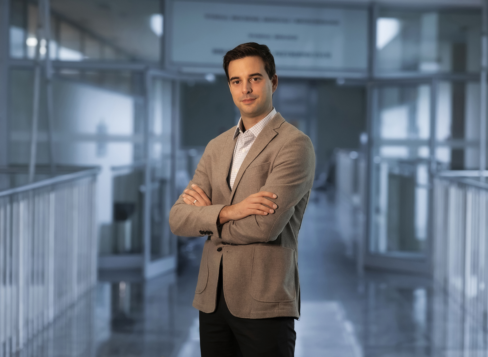
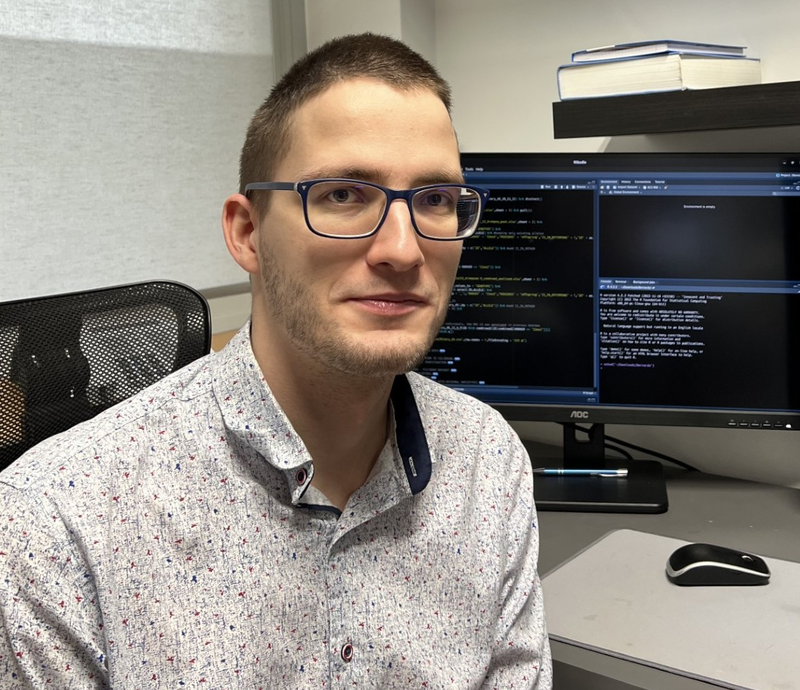
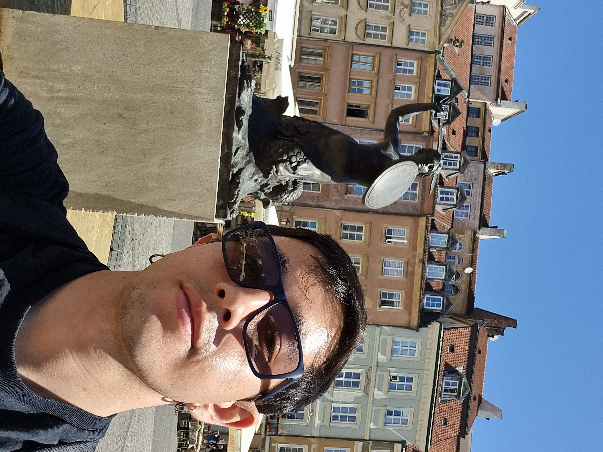
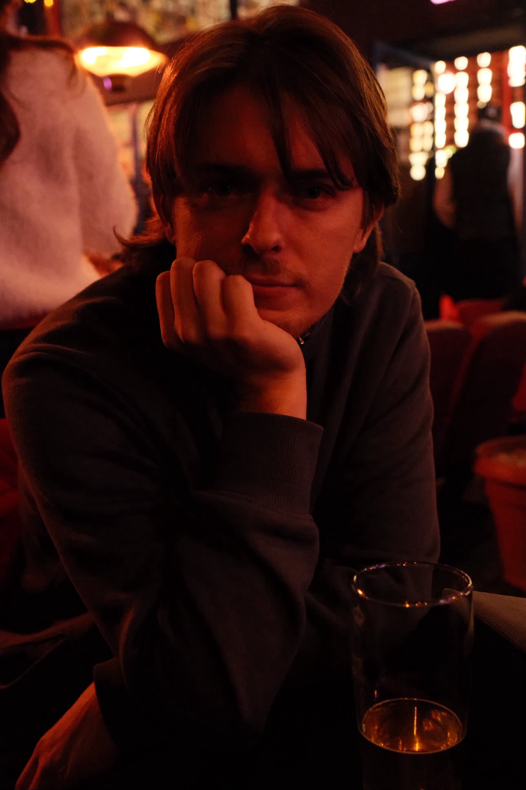

## Group Leader

Guillem Ylla, Ph.D.

[ LinkedIn](https://www.linkedin.com/in/gylla)&nbsp;
[ GitHub](https://github.com/guillemylla)

---

## Postdocs

Tomasz Gaczorek, Ph.D.

Nuria Farrús, Ph.D.

Agata Kalita, Ph.D.

---

## Ph.D. Students

Rafał Miłodrowski, Ph.D. Student in Bioinformatics.

Krystian Komenda, Ph.D. Student in Bioinformatics.

Mateo A. Alvarado-Lopez, Ph.D. Student in Bioinformatics.

Karina Galčenko, Ph.D Student in Bioinformatics.

Diego Montiel Ayora, Ph.D Student in Bioinformatics.

---

## Master Students

- Piotr Michnal, Master Student in Bioinformatics.
- Mikołaj Radosz, Master Student in Biotechnology.

## Bachelor students

- Natalia Jaworska
- Victoria Miśkowicz

---

## Former Lab Members

- Sara Herrera, vising Ph.D. student (2021).
- Evgenii Baiakhmetov,  Visiting scientist (2022).
  * While in the lab, Evgenii developed a comprehensive [Genome assembly tutorial ]( https://niwdoog.github.io/Genome_Assembly_Long_Reads_Hi-C/)
- Michał Zawisza, visiting Ph.D. student from Barcelona University.
- Gabriela Machaj, Ph.D. (2021-2024)
- Edossa Fikiru, Ph.D. (2023-2025)
- Szymon Szrajer, B.Sc.+M.Sc. (2022-2025)
- Dominik Robak, M.Sc. (2022-2025)
- Takahisa Yamashita, Ph.D (2023-2026)

